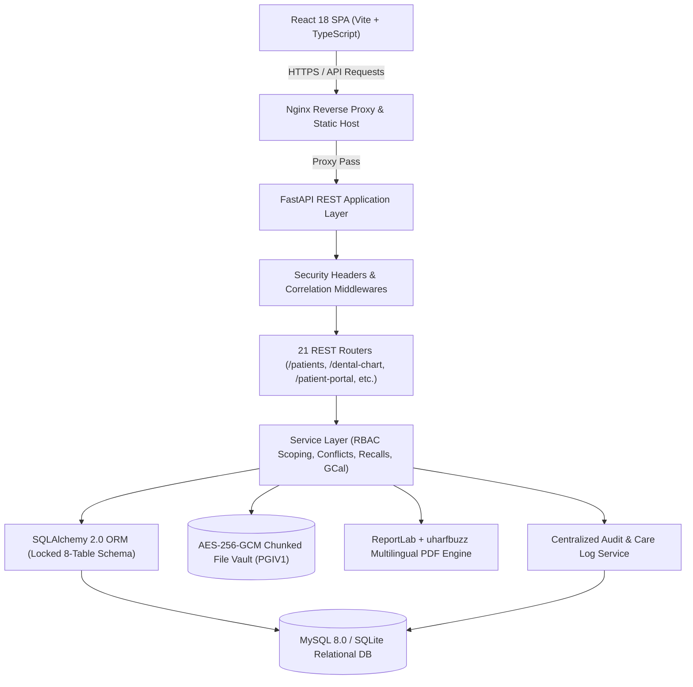
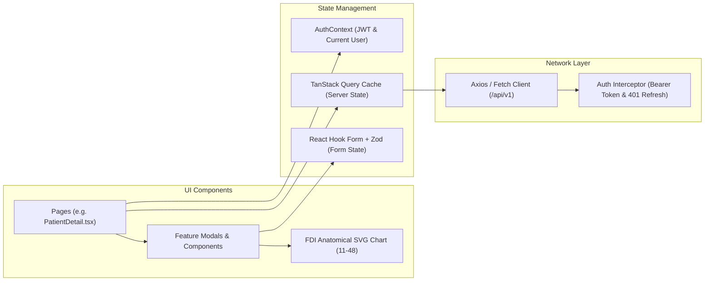
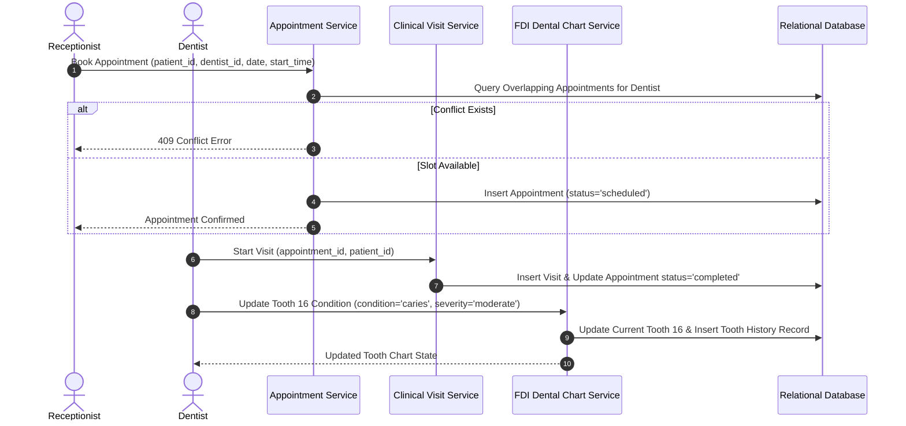

# PGI Dental Management System - System Architecture Document

## 1. Architectural Philosophy & Overview

The **PGI Dental Management System** (Oral Health Sciences Centre, PGIMER Chandigarh) is architected as a **stateless, modular monolith**. The system decouples presentation, orchestration, and persistence into clear architectural layers, ensuring that business logic, RBAC patient isolation, and AES-256-GCM media encryption are strictly enforced in backend services.

---

## 2. Layered Backend Design

The backend enforces strict separation of concerns across 5 distinct tiers:

### 1. Delivery Tier (`app/routers/`)
- Pure HTTP handling: Parameter deserialization, request schema validation, status code assignment, and content negotiation.
- Implements dependency injection for user authentication (`get_current_user`) and RBAC verification (`require_roles`).
- Zero direct database mutations or business calculations occur within routers.

### 2. Service Tier (`app/services/`)
- Contains 100% of domain business logic.
- Atomic business transactions, conflict detection (doctor & operatory double-booking), automatic recalls, Google Calendar `.ics` generation, and tooth/perio condition history creation.
- Explicit transactional scope management with automated rollbacks on failure.

### 3. Model & Persistence Tier (`app/models/` & `app/database.py`)
- Declarative SQLAlchemy 2.0 ORM entity definitions locked to **strictly 8 tables** (`doctors`, `students`, `patients`, `users`, `appointments`, `clinical_records`, `documents`, `care_and_system_logs`).
- Explicit foreign keys (`ON DELETE SET NULL` for flexible academic pool assignments), JSON payload columns (`payload_json`, `dental_chart_json`, `perio_chart_json`, `misc_records_json`), soft-delete flags (`is_deleted`), and timestamp tracking (`created_at`, `updated_at`).

### 4. Security Tier (`app/security/`)
- Cryptographic password hashing using Bcrypt.
- JWT access token minting with `token_version` & `revoked_at` validation for instant student/staff revocation.
- Cryptographically random refresh token rotation with SHA-256 hash storage.
- Declarative role-permission matrix (`require_roles`) and `verify_patient_access` scoping.

### 5. Cross-Cutting Utilities (`app/audit/`, `app/pdf/`, `app/storage/`, `app/i18n/`)
- **Centralized Audit Logger:** Captures mutating events in `care_and_system_logs` with recursive sensitive-data sanitization.
- **HarfBuzz + ReportLab PDF Generator:** Shapes English, Hindi (Devanagari), and Punjabi (Gurmukhi) prescriptions using `uharfbuzz` + `fonttools` glyph paths with bundled Noto fonts.
- **AES-256-GCM Storage Vault (`PGIV1`):** Protects uploads with 1 MB chunked AEAD encryption, magic-byte verification, SHA-256 checksums, and up to 500 MB CBCT streaming.

---

## 3. Frontend Architecture

The frontend is built on React 18, TypeScript, and Vite, prioritizing predictable state management and minimal re-renders:

### Server State vs Local UI State
- **Server State:** Managed exclusively through `@tanstack/react-query` with declarative query keys (e.g. `['patient', id]`, `['treatmentPlans', status]`). Mutations invalidate corresponding cache keys to trigger re-renders without manual state synchronization.
- **Form State:** Managed with controlled inputs and strict validation schemas.
- **Global Context:** Reserved strictly for authentication session tokens and active user profile.

---

## 4. Clinical Workflow Sequences

### Appointment & Examination Lifecycle

---

## 5. Security & Isolation Boundaries

1. **Network Boundary:** The database (`apex_dental_mysql`) is placed in an internal Docker network and is inaccessible from the public internet.
2. **Access Boundary:** Reverse proxy (Nginx) terminates external HTTP requests and applies security headers before forwarding traffic to the application server.
3. **Application Boundary:** Every route verifies authentication (valid JWT signature, unexpired token, matching `token_version`, and unrevoked `Student.revoked_at`), role authorization (`require_roles`), and patient scope (`verify_patient_access` / Patient Portal self-only isolation).
