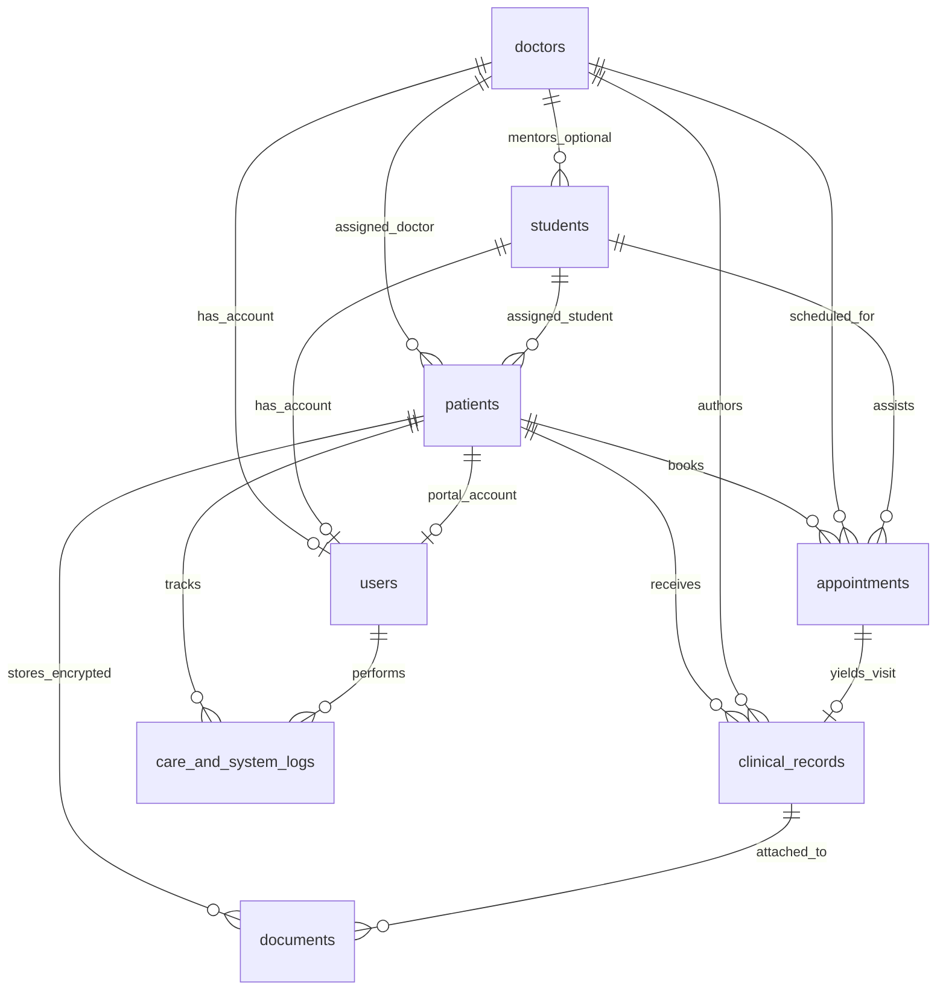

# PGI Dental Management System - Database Schema & Persistence Guide

## 1. Entity Relationship Diagram (Locked 8-Table Schema)

The database is strictly locked to **8 tables** portable across SQLite (local dev/testing) and MySQL 8.0 (production). All billing/invoice/payment tables were removed, and clinical sub-records are stored in typed JSON columns.



---

## 2. Table Specifications & Indexes

### `doctors` (`models/doctor.py`)
- Faculty clinicians and designated Admin Doctors (`is_admin=True`).
- Columns: `id` (PK), `doctor_code` (Unique, indexed), `full_name`, `email` (Unique, indexed), `phone`, `specialization`, `department`, `cabin_operatory`, `license_number`, `google_calendar_id`, `is_admin`, `is_active`, `created_at`, `updated_at`.

### `students` (`models/student.py`)
- Dental student trainees with flexible pool assignment (`doctor_id` nullable).
- Columns: `id` (PK), `student_code` (Unique, indexed), `full_name`, `email` (Unique, indexed), `phone`, `department`, `year_of_study`, `doctor_id` (FK -> `doctors.id`, nullable, `ON DELETE SET NULL`), `is_active`, `token_version`, `revoked_at`, `created_at`, `updated_at`.

### `patients` (`models/patient.py`)
- Primary patient demographic records, triage severity, and longitudinal JSON clinical stores.
- Columns: `id` (PK), `patient_code` (Unique, indexed), `cr_number` (Unique, indexed), `full_name`, `first_name`, `last_name` (indexed), `date_of_birth`, `age`, `gender`, `phone` (indexed), `email`, `address`, `emergency_contact_name`, `emergency_contact_phone`, `preferred_language` (`en`/`hi`/`pa`), `doctor_id` (FK), `student_id` (FK), `disease_categories_json`, `case_keywords_json`, `is_special_case`, `pain_scale`, `severity_level`, `registration_card_doc_id`, `consent_doc_id`, `consent_signed_at`, `medical_history_json`, `dental_chart_json` (32 FDI teeth `11–48`), `perio_chart_json` (32 teeth × 6 sites), `misc_records_json`, `patient_shared_notices_json`, `is_deleted` (soft-delete flag), `created_at`, `updated_at`.

### `users` (`models/user.py`)
- Primary identity store across all 5 roles (`admin`, `doctor`, `student`, `receptionist`, `patient`).
- Columns: `id` (PK), `email` (Unique, indexed), `username` (Unique, indexed), `hashed_password`, `full_name`, `role` (indexed), `is_admin`, `doctor_id` (FK), `student_id` (FK), `patient_id` (FK), `is_active`, `token_version`, `revoked_at`, `refresh_tokens_json`, `failed_login_attempts`, `locked_until`, `last_login`, `created_at`, `updated_at`.

### `appointments` (`models/appointment.py`)
- Clinic consultation schedule, operatory allocation, and attendance tracking.
- Columns: `id` (PK), `patient_id` (FK), `doctor_id` (FK, indexed), `student_id` (FK, nullable), `appointment_date` (indexed), `start_time`, `end_time`, `appointment_type`, `operatory`, `status` (indexed), `attendance_status` (`pending`/`checked_in`/`present`/`completed`/`missed`), `is_missed`, `missed_reason`, `cancellation_reason`, `google_event_id`, `notes`, `created_at`, `updated_at`.

### `clinical_records` (`models/clinical_record.py`)
- Polymorphic clinical record store (`record_type` = `visit` | `treatment_plan` | `surgical_log` | `prescription` | `rx_template`).
- Columns: `id` (PK), `patient_id` (FK, nullable for templates), `doctor_id` (FK), `student_id` (FK, nullable), `appointment_id` (FK, nullable), `record_type` (indexed), `record_date`, `title`, `language` (`en`/`hi`/`pa`), `status`, `is_visible_to_patient`, `payload_json`, `created_at`, `updated_at`.

### `documents` (`models/document.py`)
- Metadata for AES-256-GCM encrypted files (`PGIV1`) stored in `backend/uploads/vault/`.
- Columns: `id` (PK), `patient_id` (FK, indexed), `clinical_record_id` (FK, nullable), `document_type`, `title`, `disease_category`, `treatment_stage`, `media_date`, `is_shared_with_patient`, `file_name`, `original_file_name`, `storage_key`, `file_size`, `mime_type`, `sha256_checksum`, `is_encrypted`, `encryption_iv`, `uploaded_by_user_id`, `created_at`.

### `care_and_system_logs` (`models/care_log.py`)
- Unified operational, communication, and compliance log (`event_type` = `enquiry` | `followup` | `recall` | `notification` | `audit` | `clinic_config`).
- Columns: `id` (PK), `event_type` (indexed), `patient_id` (FK, nullable), `assigned_doctor_id` (FK, nullable), `assigned_student_id` (FK, nullable), `actor_user_id` (FK, nullable), `status`, `scheduled_date`, `channel`, `language`, `title`, `payload_json`, `created_at`, `updated_at`.

---

## 3. Data Integrity & Preservation Rules

1. **Hard 8-Table Cap:** New clinical/operational features extend JSON payloads in `patients`, `clinical_records`, or `care_and_system_logs` rather than adding tables.
2. **No Accidental Clinical Cascade Deletes:** Patient deletion uses soft deletion (`is_deleted = True`) while preserving longitudinal clinical records, and trainee/doctor reassignments use `ON DELETE SET NULL` so clinical history is never lost.

---

## 4. Alembic Migration Commands

```bash
cd backend

# Generate a new migration after model modifications
alembic revision --autogenerate -m "describe_changes"

# Apply pending migrations to database
alembic upgrade head

# Rollback one migration step
alembic downgrade -1

# Show migration history
alembic history --verbose
```
