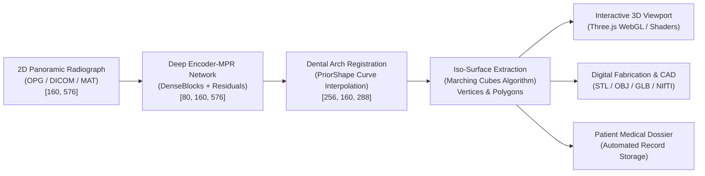

# Oral-3D: Deep Learning 3D Teeth & Oral Cavity Reconstruction in PGI Dental Management System

[](https://ojs.aaai.org/index.php/AAAI/article/view/16135)
[](https://pytorch.org)
[](https://threejs.org)
[](https://fastapi.tiangolo.com)
[](https://opensource.org/licenses/MIT)

This module integrates the state-of-the-art **Oral-3D** deep learning framework into the **PGI Dental Management System** (Oral Health Sciences Centre, PGIMER Chandigarh), providing dental clinicians and oral surgeons with real-time 3D teeth, jawbone, and arch structure reconstruction directly from standard 2D panoramic radiographs (OPGs).

Clinicians access this capability within the Doctor Portal under the dedicated **X-rays** suite and inside every patient's longitudinal record under the **X-rays (3D)** tab.

---

## 🔬 Scientific Background & Paper Citation

Based on the AAAI conference research paper:
> **"Oral-3D: Reconstructing the 3D Structure of Oral Cavity from Panoramic X-Ray"**  
> *Weinan Song, Yuan Liang, Jiawei Yang, Kun Wang, Lei He*  
> *Proceedings of the AAAI Conference on Artificial Intelligence (AAAI '21), Vol. 35, No. 1, pp. 566–573.*

```bibtex
@inproceedings{song2021oral,
  title={Oral-3d: Reconstructing the 3d structure of oral cavity from panoramic x-ray},
  author={Song, Weinan and Liang, Yuan and Yang, Jiawei and Wang, Kun and He, Lei},
  booktitle={Proceedings of the AAAI conference on artificial intelligence},
  volume={35},
  number={1},
  pages={566--573},
  year={2021}
}
```

---

## ⚙️ AI Reconstruction Pipeline



1. **Input Radiograph Ingestion:**
   The clinician uploads a 2D dental orthopantomogram (OPG) or selects a clinical reference scan. The scan is standardized to spatial dimensions `[160, 576]` with adaptive histogram equalization (CLAHE) options.

2. **Encoder-MPR Network:**
   A dense-block generative encoder synthesizes a flattened Multi-Planar Reconstruction (MPR) density tensor of shape `[80, 160, 576]`, recovering depth cues lost during panoramic projection.

3. **Dental Arch Spatial Registration (`PriorShape`):**
   Using non-linear spatial interpolation along the anatomical dental arch prior curve, the MPR tensor is projected back into Cartesian 3D coordinates `[256, 160, 288]`.

4. **Iso-surface Extraction (Marching Cubes):**
   Extracts high-precision triangular meshes separating hard enamel crowns and alveolar bone from soft oral mucosa based on adjustable density isovalues (`-0.80` to `+0.10`).

5. **Biometric Measurement Calculation:**
   Extracts clinical spatial extents (Dental Arch Width, Depth, Height in millimeters) and hard tissue volume (cm³).

---

## 🏥 Doctor Portal Capabilities (`X-rays`)

### 1. Dedicated Doctor Navigation
Accessible to doctors, assigned students, and administrators from the main sidebar:
- **Navigation Name:** `X-rays` (Icon: `Scan`)
- **Route:** `/xrays`
- **Role Permissions:** `doctor`, `admin`, `student` (scoped via `verify_patient_access`)

### 2. Clinical Diagnostic Studio Features
- **Patient Selector:**
  Directly associate the 3D reconstruction with any authorized patient in the clinic database (search by patient name, CR Number, or code `PAT-xxxx`), or evaluate independent diagnostic scans.
- **Interactive Three.js WebGL Viewport:**
  - OrbitControls (smooth damping, rotate, pan, zoom, reset view)
  - 5 Diagnostic Medical Shaders:
    - **Enamel Bone:** Natural ivory subsurface physical material with enamel gloss
    - **CT Heatmap:** Hounsfield density color mapping (sky-blue to warm density)
    - **Wireframe:** Mesh topology and polygon density inspection
    - **Surface Normals:** Curvature and surface orientation diagnostics
    - **Translucent X-Ray:** Semi-transparent depth visualization (opacity 0.45)
  - 6 Anatomical Camera View Presets:
    - Anterior (Front)
    - Upper Arch (Maxillary occlusal)
    - Lower Arch (Mandibular occlusal)
    - Left Lateral
    - Right Lateral
    - Isometric 3D
  - Visual helpers: Ground coordinate grid, Bounding Box helper, Turntable auto-rotation, Fullscreen mode.

### 3. Multi-Planar Reconstruction (MPR) Orthogonal Slices
Interactive scrubbers allow real-time volume slicing along:
- **Axial Plane (Z):** Horizontal dental arch plane (indices 0 to 159)
- **Coronal Plane (Y):** Frontal plane (indices 0 to 255)
- **Sagittal Plane (X):** Lateral cross-section (indices 0 to 287)

### 4. Dental Arch Biometrics Card
- **Arch Width (mm):** Transverse distance across second molars.
- **Arch Depth (mm):** Antero-posterior distance from central incisors to molar tangent.
- **Arch Height (mm):** Cranio-caudal dental arch height.
- **Hard Tissue Volume (cm³):** Calculated watertight mesh volumetric displacement.

### 5. Multi-Format 3D Export Suite
- **Download STL:** Ready for 3D Dental Printing (clear aligners, surgical guides, occlusal splints).
- **Download OBJ:** Compatible with dental CAD suites (Exocad, 3Shape, Blender).
- **Download GLB:** Lightweight binary format for mobile, web, and AR review.
- **Download NIfTI (`.nii.gz`):** Formatted for medical imaging workstations (3D Slicer, ITK-SNAP).

### 6. Patient Dossier Integration (`/patients/:id`)
Under the **X-rays (3D)** tab in the patient chart:
- View all 2D panoramic radiographs and 3D dental reconstructions stored for that patient.
- Embedded interactive 3D viewer directly inside the patient's medical dossier.
- One-click **"Open X-rays Studio"** preloaded with the patient's record.
- Automatic audit trail logging for medical compliance and record security.

---

## 📡 Backend API Endpoints

Mounted under `/api/v1/xrays`:

| Method | Endpoint | Description | Role Required |
|---|---|---|---|
| `GET` | `/api/v1/xrays/status` | Connectivity & neural model status of Oral-3D engine | `doctor`, `admin`, `student` |
| `GET` | `/api/v1/xrays/samples` | Clinical sample panoramic radiograph presets | Authenticated |
| `POST` | `/api/v1/xrays/reconstruct` | Ingests radiograph, executes inference, returns 3D mesh & MPR | `doctor`, `admin`, `student` |
| `GET` | `/api/v1/xrays/slice` | Streams dynamic cross-section image along Axial/Coronal/Sagittal | `doctor`, `admin`, `student` |
| `POST` | `/api/v1/xrays/save-to-patient`| Persists 3D reconstruction & metrics into patient's AES-256-GCM vault | `doctor`, `admin`, `student` (scoped) |
| `GET` | `/api/v1/xrays/patient/{id}` | Retrieves all X-rays & 3D models on file (date-wise category grouping) | `doctor`, `admin`, `student` (scoped) |

---

## 🚀 Quick Start Guide

### One-Click Startup (Windows)
Run `start.bat` from the root directory:
```cmd
start.bat
```
This automatically launches:
1. **Oral-3D AI Reconstruction Engine:** `http://127.0.0.1:8001` (FastAPI + PyTorch)
2. **PGI Dental Backend:** `http://127.0.0.1:8000` (FastAPI + SQLAlchemy)
3. **PGI Dental Frontend:** `http://localhost:3000` (Vite + React + Three.js)

### Manual Service Startup
1. **Start Oral-3D Engine (Port 8001):**
   ```bash
   python app.py --port 8001
   ```

2. **Start PGI Dental Backend (Port 8000):**
   ```bash
   cd backend
   .venv/bin/uvicorn app.main:app --host 127.0.0.1 --port 8000
   ```

3. **Start Frontend (Port 3000):**
   ```bash
   cd frontend
   npm run dev
   ```

4. **Login as Clinician:**
   - **Email:** `dr.sharma@pgi.edu.in`
   - **Password:** `Dental@123`
   - Click **X-rays** in the sidebar.
