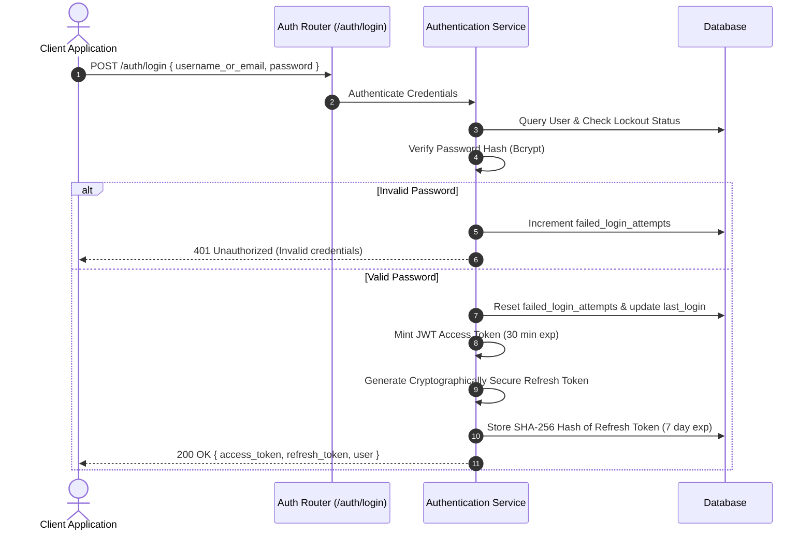

# PGI Dental Management System - Security Architecture & Threat Model

## 1. Overview & Threat Model

Patient health information (PHI) and clinical records require rigorous, defense-in-depth protection. The security model adheres to HIPAA Security Rule guidelines and OWASP Top 10 recommendations.

| Threat Category | Potential Risk | Mitigation in PGI Dental Management System |
|---|---|---|
| **Injection (SQLi)** | Malicious SQL payloads in searches | SQLAlchemy 2.0 parameterized queries exclusively. Zero raw SQL string concatenation. |
| **Broken Access Control / IDOR** | Student viewing another trainee's patient, Receptionist opening EMR, or Patient reading internal notes | Backend-enforced `require_roles` and `verify_patient_access` dependencies. Patient Portal isolated strictly to `/api/v1/patient-portal/*`. |
| **Authentication & Revocation** | Brute-force attacks, revoked trainee still holding an unexpired JWT | Bcrypt password hashing, short-lived JWT access tokens, refresh token rotation, account lockout after 5 failed logins, and `token_version` + `Student.revoked_at` instant JWT invalidation. |
| **Cryptographic Failures** | Data leakage on disk or over unencrypted channels | AES-256-GCM (`PGIV1`) encrypted file vault (`file_storage.py`), TLS in production, no sensitive plaintext in logs. |
| **Security Misconfiguration** | Stack trace leaks, default credentials | Custom exception handlers returning uniform sanitized JSON errors. Production config validation at startup. |
| **Vulnerable & Outdated Components** | Vulnerabilities in third-party libraries | Automated dependency auditing and pinned versions in `requirements.txt` and `package-lock.json`. |
| **Path Traversal / Malicious Uploads** | Overwriting server files via uploaded X-rays/CBCT | Extension allowlist/blocklist, magic-byte inspection, UUIDv4 vault keys, files stored encrypted outside web root. |

---

## 2. Role-Based Access Control (RBAC) Matrix

Permissions are strictly enforced on backend endpoints regardless of client interface state:

| Resource / Action | Admin / Admin-Doctor | Doctor | Student | Receptionist | Patient (Portal) |
|---|:---:|:---:|:---:|:---:|:---:|
| **Manage Doctors / Students / Users** | ✅ Full Access | ❌ Denied (403) | ❌ Denied (403) | ❌ Denied (403) | ❌ Denied (403) |
| **Patient Directory & Registration** | ✅ All Branch | ✅ All Branch | ✅ Assigned Only | ❌ Denied (403) | ❌ Denied (403) |
| **Attendance & Walk-In Check-In** | ✅ Full Access | ✅ Full Access | ❌ | ✅ Attendance Only | ❌ Denied (403) |
| **Clinical EMR (FDI / Perio / Visits / Surgical)** | ✅ Full Access | ✅ Full Access | ✅ Assigned Only | ❌ Denied (403) | ❌ Denied (403) |
| **Prescriptions & HarfBuzz PDF** | ✅ Create / Download | ✅ Create / Download | ✅ Assigned Only | ❌ Denied (403) | ✅ Self Visible Only |
| **Encrypted X-Rays / Media / CBCT** | ✅ Upload / Download | ✅ Upload / Download | ✅ Assigned Only | ❌ Denied (403) | ✅ Opt-in Shared Only |
| **Audit Logs Inspection** | ✅ Full Access | ❌ Denied (403) | ❌ Denied (403) | ❌ Denied (403) | ❌ Denied (403) |

---

## 3. Authentication & Session Security

### Key Security Safeguards
1. **Instant Student & Session Revocation:** Removing a student (`DELETE /students/{id}`) increments `token_version` and sets `revoked_at`, invalidating active JWTs immediately in `get_current_user`. Refresh token revocation (`POST /auth/logout`) marks tokens revoked.
2. **Account Lockout:** 5 consecutive failed login attempts trigger an automated account lock (`locked_until`).
3. **No Credential Logging:** Passwords, JWT tokens, and refresh tokens are strictly scrubbed prior to audit trail recording in `care_and_system_logs`.

---

## 4. AES-256-GCM Encrypted File Vault (`PGIV1`)

Uploaded clinical documents, photos, and CBCT radiographs are protected through a multi-stage verification and encryption pipeline in `backend/app/storage/file_storage.py`:

1. **Size Verification:** Standard clinical documents/photos allow up to `25 MB`; 3D CBCT scans (`.dcm`, `.zip`, `.nii`, `.nii.gz`) allow up to `500 MB`.
2. **Extension Allowlist & Blocklist:** Permits verified clinical formats (`.jpg`, `.jpeg`, `.png`, `.webp`, `.pdf`, `.dcm`, `.tiff`, `.zip`, `.nii`, `.nii.gz`) and blocks executables/scripts (`.exe`, `.sh`, `.js`, `.html`, `.svg`, etc.).
3. **Magic-Byte / MIME Verification:** File header bytes are inspected to prevent extension spoofing.
4. **AES-256-GCM Chunked Encryption:** Files are encrypted at rest using `PGIV1` header + 12-byte base nonce + `1 MB` chunks, with SHA-256 integrity checksums.
5. **Storage Outside Web Root:** Encrypted `.enc` files live under `backend/uploads/vault/{patient_id}/{uuid}.enc` and are never served statically.
6. **Authorized Streaming:** `GET /documents/{id}/download` verifies `verify_patient_access` (or `is_shared_with_patient == True` for Patient Portal), logs an audit record, and streams decrypted chunks.

---

## 5. Patient Portal Privacy Isolation

Patient users (`role="patient"`) can access only `/api/v1/patient-portal/*`:
1. **Appointments:** Returns only the patient's own slots, operatory, doctor display name, pre-appointment hints, and calendar exports.
2. **Prescriptions & Care Instructions:** Returns only patient-visible prescriptions and notification/recall care alerts.
3. **Shared Records:** Returns **only** explicit doctor-issued notices and documents with `is_shared_with_patient == True`. Internal visits, FDI/Perio charts, surgical logs, and unshared X-rays are strictly excluded.

---

## 6. Security Vulnerability Reporting

To report a suspected security vulnerability, please contact the PGI Dental System administrators. We respond promptly and practice coordinated disclosure.
